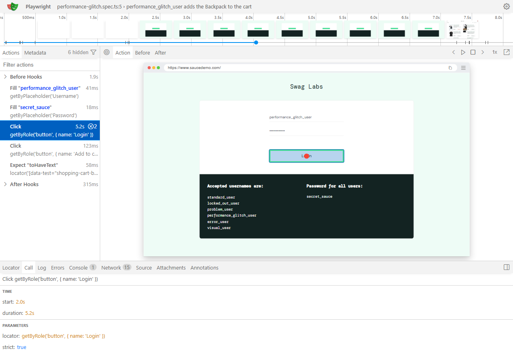

# UI test mutation proof

## Shared authentication timing

Measured with `npx playwright test --workers=1`:

| Run                                                                |               Tests | Playwright duration | Wall-clock duration |
| ------------------------------------------------------------------ | ------------------: | ------------------: | ------------------: |
| Before shared authentication (`b150fa4`)                           |                  15 |              27.4 s |             32.64 s |
| After shared authentication (full suite)                           | 21, including setup |              40.7 s |             42.00 s |
| After shared authentication (baseline-equivalent tests plus setup) |                  16 |              23.3 s |             25.99 s |

The full-suite timings are not directly comparable because the current suite has six more tests. For a closer comparison, the baseline-equivalent run excluded the four added login-user cases and the performance-glitch test; it retained the original test coverage and includes the new setup test. With one worker, that run was 6.65 seconds faster wall-clock than the 15-test baseline, even with setup included. Locally, parallel workers can overlap the individual logins in the baseline, while the shared-auth setup login runs once before dependent tests.

Each of the 10 UI tests was run with the listed behavior broken and then rerun successfully after the behavior was restored. The two initially weak assertions were also rerun with their original mutations after being corrected; those runs failed as expected.

| Test                                                | What I broke                                             | Did it fail?                                                          |
| --------------------------------------------------- | -------------------------------------------------------- | --------------------------------------------------------------------- |
| logs in successfully                                | Used `wrong_password` instead of `secret_sauce`.         | Yes; passed after restoring the valid password.                       |
| shows an error for an incorrect password            | Used the valid password `secret_sauce`.                  | Yes; passed after restoring the incorrect password.                   |
| shows an error for a locked-out user                | Used `standard_user` instead of `locked_out_user`.       | Yes; passed after restoring the locked-out user.                      |
| displays six items sorted by price from low to high | Selected high-to-low sorting instead of low-to-high.     | Yes; passed after restoring low-to-high sorting.                      |
| opens an item and returns to the inventory          | Opened the Bike Light instead of the requested Backpack. | Initially no; yes after asserting the exact detail-page product name. |
| adds two items to the cart                          | Expected a badge count of `3` instead of `2`.            | Yes; passed after restoring the expected count.                       |
| completes an order and shows confirmation           | Skipped the Finish button click.                         | Yes; passed after restoring the click.                                |
| logs out                                            | Skipped the Logout button click.                         | Initially no; yes after asserting the logged-out username field.      |
| opens the About page                                | Skipped the About link click.                            | Yes; passed after restoring the click.                                |
| opens the dynamic catalog spinner                   | Skipped the Spinner button click.                        | Yes; passed after restoring the click.                                |

The logout test passed before because its URL assertion only checked the site domain, which also matches the still-logged-in inventory page. It now checks that the Username field appears after logout.

The item test passed before because its generic inventory-item visibility assertion did not verify which product opened; the inventory list was already visible before the click. It now checks the exact product name on the detail page.

`test.fail()` marks a test as expected to fail, so if it passes unexpectedly, Playwright reports it as an unexpected pass and the test run fails. This is useful because it signals that the known defect may have been fixed and the expected-failure marker should be revisited.

## Parameterized login test listing

Output of `npx playwright test --list`:

```text
Listing tests:
  [setup] › auth.setup.ts:6:6 › authenticate
  [chromium] › api\demo.spec.ts:3:5 › get api test
  [chromium] › api\demo.spec.ts:14:5 › post api test
  [chromium] › api\demo.spec.ts:33:5 › PUT api test
  [chromium] › api\demo.spec.ts:55:5 › delete api test
  [chromium] › cart-checkout.spec.ts:4:7 › Cart and checkout › adds two items to the cart
  [chromium] › cart-checkout.spec.ts:12:7 › Cart and checkout › completes an order and shows confirmation
  [chromium] › inventory.spec.ts:4:7 › Inventory › displays six items sorted by price from low to high
  [chromium] › inventory.spec.ts:16:7 › Inventory › opens an item and returns to the inventory
  [chromium] › login-audit.spec.ts:14:7 › Login audit persistence tests › persists and reads a login audit record
  [chromium] › login.spec.ts:19:9 › Login › logs in as standard_user
  [chromium] › login.spec.ts:19:9 › Login › logs in as locked_out_user (error)
  [chromium] › login.spec.ts:19:9 › Login › logs in as problem_user
  [chromium] › login.spec.ts:19:9 › Login › logs in as performance_glitch_user
  [chromium] › login.spec.ts:19:9 › Login › logs in as error_user
  [chromium] › login.spec.ts:19:9 › Login › logs in as visual_user
  [chromium] › login.spec.ts:19:9 › Login › logs in as wrong_password_user (error)
  [chromium] › navigation.spec.ts:3:7 › Navigation › logs out
  [chromium] › navigation.spec.ts:8:7 › Navigation › opens the About page
  [chromium] › navigation.spec.ts:13:7 › Navigation › opens the dynamic catalog spinner
  [chromium] › performance-glitch.spec.ts:6:5 › performance_glitch_user adds the Backpack to the cart
  [chromium] › problem-user.spec.ts:9:7 › Problem user › completes checkout
Total: 22 tests in 9 files
```

## Performance glitch user trace

Ran `npx playwright test tests/performance-glitch.spec.ts --trace on --reporter=line` and opened its trace with `npx playwright show-trace`. The trace showed that login took **5.2 seconds**, and the test passed without any changes. Adding a `toBeVisible()` assertion before clicking Add to cart made the test flaky because that assertion has a separate 5-second timeout. The click already waits for the button using the full test timeout, so the assertion was unnecessary; removing it fixed the flakiness.



## Database audit insert mutation proof

Temporarily changed `UserRepository.insertLoginResult` into a no-op, then ran
`npx playwright test tests/login-audit.spec.ts --workers=1 --reporter=line`.
The audit test failed at `toHaveLength(1)` with **Expected length: 1; Received
length: 0**, demonstrating that the test detects a missing insert. Restored the
repository insert and reran `npm test -- --workers=1 --reporter=line`; all 22
tests passed. A read-only SQLite query after the run returned zero rows from
`login_results`, confirming that `afterEach` cleanup ran.

## API booking update mutation proof

Temporarily changed `BookingClient.update` to return `{ status: 200, body: booking }`
without sending an HTTP request, then ran
`npx playwright test tests/api/booking.spec.ts --reporter=line`. Both API tests
failed as expected:

- The unauthenticated update check expected **403** but received **200**.
- The lifecycle test read the booking back and expected the updated first name
  `"Roshik1793263399937491Updated"` but received the unchanged
  `"Roshik1793263399937491"`.

This confirms the tests detect both the missing request and the unchanged saved
booking. Restored `BookingClient.update` to send the PUT request. The first
full-suite run had **19 passed and 1 failed** because the About-page test timed
out waiting for its link; reran `npm test -- --reporter=line` with the restored
code and all **20 tests passed**.
